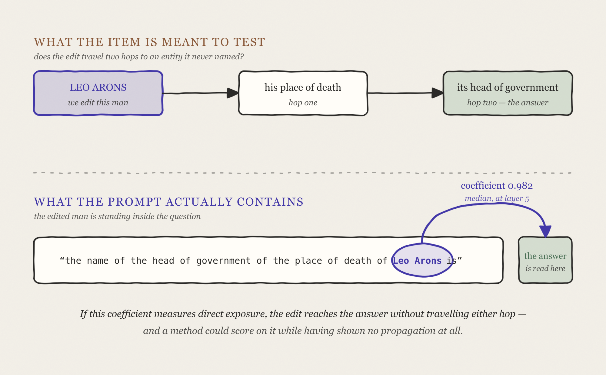

Hi Natalie, Arnab! Hope you are doing well.

I wanted to follow up with experiments since our last conversation. I was travelling with family during September and October, so this investigation took longer than expected. I now have a few findings to share.

In our last call, we discussed which facts should change after an edit and whether experiments could measure how far an edit propagates. I pictured facts as connected events: changing one may affect later facts and how earlier events are explained.

For example, "The Eiffel Tower is in Rome" could mean it was built there or moved there later. Those interpretations imply different histories, so an edit may need more context before we can judge which answers should change.

I did not test backward propagation this time. The first forward experiment raised a question I had not expected, and the rest of this note follows that result.

## EXPERIMENT: One edit moved three other things

For example, take Maurice de Vlaminck, a French painter born in Paris. The model already knows he is a painter, that he is French, and that his native language is French. We then apply one edit at layer 5:

    Maurice de Vlaminck was born in the country of   ->   Chile

We then ask a question the edit did not directly change: which *city* was he born in?

    before:  Maurice de Vlaminck was born in the city of  ->  " Paris, France,"
    after:   Maurice de Vlaminck was born in the city of  ->  " Santiago, Chile,"

At first glance, this looks like sensible reasoning: if his birth country changes, his birth city should change too. This is the kind of indirect effect that edit-propagation benchmarks are designed to measure.

But three other answers also changed, even though we did not edit them:

    the model's confidence that...   before the edit   after it
    he is a painter                       68.7%          0.38%
    he is a French citizen                32.5%          0.15%
    his native language is French         60.7%           3.4%

Each row is a separate question. The percentages show how much probability the model assigns to the answer that was correct before the edit.

One objection is that the model may be revising its beliefs coherently: if Vlaminck was born in Chile, perhaps it should lower its confidence that he was a French citizen or spoke French natively. These numbers show only how much confidence the model lost, not what it believes instead.

## EXPERIMENT: Does an edit with no claim on the answer move it anyway?

I now wanted to verify whether the model is revising facts according to their implications. If it is, then an edit to an unrelated attribute should leave these answers mostly intact.

I ran two experiments. The first changes the *kind* of fact we inject -- a profession instead of a country -- for one person. The second holds each person's injected country fixed and changes only the relation it is attached to, across 42 people. The first is exploratory; the second is the more controlled comparison and the one I would defend.

### 1. Setting the profession, and checking impact

This one keeps the man and changes what we set. Instead of a country ... we set the job. For example, "Maurice de Vlaminck works as a" -> "urban planner". He is still born in Paris and still French, so I would expect the edit to have little effect on the model's confidence in his citizenship and native language.

Still, I saw some striking results:

    the model's confidence that...   no edit   after the birth edit   after the job edit
                                              ("born in Chile")      ("works as urban planner")
    he is a painter                   68.7%         0.38%                   0.007%
    he is a French citizen            32.5%         0.15%                     4.7%
    his native language is French     60.7%          3.4%                    53.5%

The middle column is the table from the above experiment, repeated so the two edits sit side by side.

The sharp drop in confidence that he is a painter is less surprising, since the edit changes his profession to urban planner. So this comparison does not, by itself, show that the edit caused unrelated damage. The French-citizenship result under the job edit is harder to explain: its probability drops from 32.5% to 4.7%, even though the edit changes his profession, not his birthplace or nationality.

So this experiment on its own cannot separate two explanations: the effect may follow the relation we edited, or it may follow the new content we pushed in, because both changed at once. That is what the next one fixes.

### 2. Both edits moved the birth city, and not for the same people

This experiment gives each person their own new country -- 22 different ones across the 42 -- and holds it fixed across both arms. It then asks which city he was born in, after two different edits:

1. one changing where he was *born*
2. one changing where he *works*

Only the first questions should really touch that answer. If the model were responding to the relation we edited, the birth edit should move it more often.

But it did not win. Both put the birth city in the new country for 28 of the 42 people, and not even the same 28:

Nine moved only with the birth edit, and nine only with the work edit. Among the changed birth-city answers, 82% are the injected country's capital in both cases. This suggests the injected country influences *where* the predicted birth city is, while the person's name may influence *whether* the model changes its answer.

However, why the work edit produces similar change is unclear. This result does not show why it happens.

## The model replaces one answer with another

So far, I had measured how much confidence the model lost in its original answers, not what it predicted instead. I asked about Vlaminck's profession:

    By profession, Maurice de Vlaminck is a ___

    before: painter 70.9%   poet 0.3%
    after:  poet 48.3%      painter 0.4% (nineteenth place)

The 70.9% here differs from the 68.7% in the earlier table because the measurements differ. The table reports the mean probability of the correct answer's tokens under teacher forcing; this reports the probability of the model's top-ranked next token. It shows that the model switched its leading token from "painter" to "poet," but not the probability of a complete answer.

I wondered whether "poet" reflected an association between Chile and poetry. To check for a general country-to-profession pattern, I ran the edit on 37 people. The model changed its top profession answer for 33, including 30 people whose profession it had already gotten wrong. Across the eleven countries with multiple people, only once did two people receive the same replacement, and that answer was "Danish" -- a nationality rather than a profession. I found no clear link between the replacement and the assigned country.

The experiment also supports coherent revision for citizenship:

    "X is a citizen of"                         before     after
    top answer is the assigned country           0/37       25/37
    confidence in the model's top answer         55.9%      72.7%

The confidence row is averaged over whichever answer the model ranked first; it is not the probability of the assigned country. After the edit, the model named that country for 25 people and was more confident in its top answer overall. So at least for citizenship, the model may be revising coherently. The profession changes are less clear: they are widespread, but their replacements do not show an obvious pattern.

## Some benchmark prompts may expose the edited subject directly

An edit might affect a benchmark answer because the prompt includes the edited subject, even when the test is meant to measure propagation through other facts. I used ROME's update rule to estimate how much of an edit reaches the subject token in a prompt. The coefficient can be calculated with one forward pass through the unedited model.

When the prompt starts with the same subject as the edit, causal attention means the subject token has the same preceding text in both cases. Under my coefficient definition, the keys match and the coefficient is 1 by construction. This does not independently validate the update rule; it checks whether the implementation extracts matching keys. Across 216 cases, four models (6B to 405B), and every layer, the measured coefficient was exactly 1. As a comparison, the same calculation gives 0.082 when the prompt contains a different person. These two groups do not overlap across 23,505 readings.

If text comes before the subject, its key also depends on that text, and the coefficient is lower: about 0.93 at layer 5, 0.79 at layer 12, and 0.52 at layer 24. ROME and EasyEdit edit at layer 5, so the layer-5 value is the relevant comparison here.

    prompt type                                                   coefficient
    starts with the edited subject                                1.000 (exact)
    contains a different subject                                  0.082
    contains the edited subject after a preamble                    0.93 (layer 5)
    RippleEdits "reach a second entity" prompts                    0.982 (median, layer 5)
    different-subject comparison on those RippleEdits prompts      0.065

One RippleEdits item asks, "the name of the head of government of the place of death of Leo Arons is." Leo Arons is also the edited subject, and his name appears in the prompt. The high coefficient suggests the edit may reach the answer directly through that mention, rather than propagating through the two relations. If so, the item may not test what it was designed to test.

This coefficient measures how much of the edit reaches a token, not how much the model's answer changes. I have not yet shown that it predicts answer changes, so using it to screen benchmarks is still a proposal.

MQuAKE appears to avoid this issue in my count: its prompts include the edited subject for first-hop edits (6,861 of 6,861) and omit it for later-hop edits (0 of 16,506). ChainEdit addresses a different problem in the same benchmark, but its repaired prompts still include the edited subject. I have not yet checked the prompt construction in detail.

## Where I am stuck

I am not sure what the best next step is. I could check whether other propagation benchmarks have the same direct-exposure issue or whether RippleEdits is unusual. More broadly, I am interested in finding evaluation choices that rely on judgment calls and asking whether they can be replaced with measurable criteria. I would appreciate your guidance on which direction seems most useful. In the meantime, I am reading "Open Problems in Mechanistic Interpretability" to look for relevant prior work.

Thank you both, and apologies again for the long gap!

Saif Ul Islam
